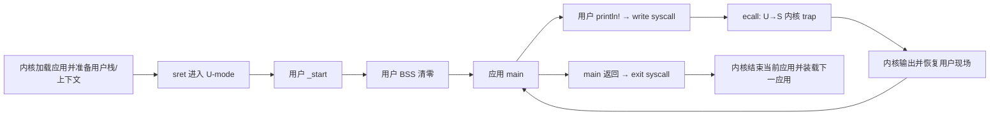

# 第三批：第二章开始——生成第一个用户应用镜像

第一章功能已通过。现在按第二章“引言 → 特权级机制 → 实现应用程序”的顺序，
先建立用户侧执行环境。核心实现由作者填写；本批完成点是一个独立的 ELF/bin，
运行结果留到内核 trap 与 U-mode 切换接好以后验证。

## 为什么要从应用开始

第一章的 Hello 在 S-mode 内核中输出。第二章要让应用运行在 U-mode，
把直接控制硬件、装载下一应用等权力留给内核。用户代码需要输出时，通过 syscall 请求服务。
特权级限制的是哪些指令/资源可以访问；地址空间隔离是另一层机制，要继续到第四章。
第二章尚无页表，不能据此声称用户与内核已经具备完整内存隔离。

**用户栈不要求先实现页表。** 本章采用普通RAM中的静态字节数组作为用户栈，
官方固定版本为4096×2字节（8KiB），由内核取其上边界作为初始sp。
这里的“准备栈”是保留一块可用内存，不是调用PMM分配页，也不是新建虚拟映射。
没有启用地址翻译时仍能通过sstatus/sret进入U-mode；特权级与地址翻译是不同机制。
页表和独立地址空间按教程顺序到第四章再实现。第二章重点是特权切换与批处理，
不是完整的用户/内核内存隔离。

本章最终路径如下。**当前批次只实现图中用户侧**：



与上一章的区别：

| 层 | 输出请求交给谁 | 退出意味着什么 |
| --- | --- | --- |
| S-mode 内核 | SBI 固件，本章仍可复用已有 console | shutdown 结束整个系统 |
| U-mode 应用 | S-mode 内核的 write syscall | exit 只结束当前应用，内核继续管理其它应用 |

syscall 与 SBI 都可使用 ecall，但特权级、调用号和服务方不同。
这里 write=64、exit=93 是教程采用的用户接口编号，不是 SBI 编号，ecall 也不会自动解释这些编号。

## 当前目录与本章后续位置

```text
rcore-learning/
  os/                     已完成的内核，当前仍正常关机
  user/
    Cargo.toml            一个用户库 user_lib + 一个 hello 应用
    src/lib.rs            用户 _start、BSS、write/exit、panic
    src/syscall.rs        ecall 寄存器包装
    src/console.rs        复用格式化机制，输出后端换成 write
    src/bin/hello.rs      应用 main
    src/linker.ld         应用链接到 0x80400000
```

后续按顺序接：内核嵌入/装载镜像 → trap 上下文保存恢复及首个 U-mode 应用 →
write/exit 分发 → 自动运行下一应用。每批先梳理路径、再给核心任务；本批不代写后面的内核。
当前 user 不接 TinyOS 根构建，也不把已有完整教程克隆切到另一分支。

## 已准备好的接线

协作者已建立用户 Cargo 包、链接脚本、离线 lock 与以下独立目标：

```sh
cd /home/asus/tinyos/experiments/rcore-learning
make user          # 生成用户 hello ELF 与 hello.bin
make user-inspect  # ELF头/程序头/符号
make user-disasm   # 用户反汇编
```

内核仍用 make build/run。make user 不运行 QEMU；**不要把 user bin 当内核传给 -bios 或直接运行它**。
Rust目标仍是 riscv64gc-unknown-none-elf，但“编译到这个目标”不决定特权级；
后续内核通过 sstatus/sret 才决定进入 U-mode。
用户入口链接到 0x80400000，预留应用窗口 128 KiB（0x20000），与官方第二章约定一致。
链接器拒绝超出窗口的内存布局，限制包括BSS，不只是bin文件长度。

不用新增第三方依赖。本批的用户库只需 core；官方完整 user Cargo 的 riscv 依赖不是此 Hello 包装的必要条件。
VS Code已显式关联用户Cargo.toml；初始 compile_error 是清楚的未完成标记，不是环境故障。
整批实现完再移除 guard，不让 todo! 留在可执行路径。

## 作者这次整批完成什么

### A. 用户 syscall 寄存器包装

填写 user/src/syscall.rs 中的三个函数。

| 寄存器 | syscall 中的含义 |
| --- | --- |
| a7 / x17 | 编号：write=64、exit=93 |
| a0 / x10 | 第一个参数；返回时是有符号结果 |
| a1 / x11 | 第二个参数 |
| a2 / x12 | 第三个参数 |

私有 syscall(id, [usize; 3]) -> isize 使用一次 inline asm ecall。
关键骨架：

```rust
let result: isize;
unsafe {
    core::arch::asm!(
        "ecall",
        // inlateout("a0") <第一个参数> => result,
        // in("a1") <第二个参数>,
        // in("a2") <第三个参数>,
        // in("a7") <编号>,
    );
}
// 返回 result
```

inlateout 说明 a0 既输入参数也输出返回值，不能只用 in 而把内核改写的结果藏起来。
本批不添加 nomem/pure/noreturn：内核会读取缓冲区，write 会返回，不能向编译器作错误保证。
将来内核 trap 必须保存并正确恢复其它寄存器，这也是用户包装成立的前提。

`sys_write(fd, buffer: &[u8])` 的三个参数是：fd、buffer.as_ptr() 转 usize、buffer.len()。
调用号使用现有 SYSCALL_WRITE；返回原始 isize。借用切片保证指针和长度来自同一块活着的缓冲区。
未来 write 内核同步消费这些字节，不保留用户借用地址供异步使用。

`sys_exit(exit_code: i32)` 使用 SYSCALL_EXIT；参数为 `[exit_code as usize, 0, 0]`。
私有寄存器包装仍允许返回，库层 exit 将对“本应不返回”的语义提供兜底。
为 asm 的 unsafe 块写明接口和寄存器保存前提，unsafe 不等于自动验证内核行为。

### B. 用户入口、BSS 与 exit

填写 lib.rs 的 clear_bss、_start、exit。入口属性与外部 main 声明已经放好。

1. clear_bss 沿用第一章的半开区间逐字节清零，边界改为用户链接脚本的 start_bss/end_bss。
2. _start 调用 clear_bss，再调用外部 Rust ABI 的 main() -> i32，把返回值传给 exit。
3. exit(code) 调用 sys_exit；若内核意外返回，留在循环兜底，不 panic，也不正常返回。

这里的 _start 是 Rust函数，运行前就需要有效sp。**用户库不再自己设置启动栈**：
后续内核创建用户TrapContext时提供用户栈顶，再通过sret进入应用。
本批没有这个内核步骤，所以静态构建通过不代表已经在U-mode运行。

外部 main 的实现来自 hello.rs，库与应用共同链接；unsafe 调用前提是签名匹配、
内核提供合法栈以及用户BSS完成初始化。固定官方版本也是这个方案。
不要引入旧文中的 feature(linkage)/weak默认main，那需要不稳定特性；本机保持stable。
已有用户 panic handler 使用固定字节诊断再 exit(1)，避免在错误处理里递归格式化。

### C. 用户格式化输出

console.rs 的两个宏和 print 错误处理已复用第一章机制。
你只需完成 Write::write_str：

1. 一次调用 `crate::write(1, text.as_bytes())`，fd=1 约定为标准输出。
2. 返回值非负且转换为usize后等于text.len()，才返回Ok(())；否则返回Err(fmt::Error)。
3. 不调用SBI，不把字符截断成u8，不忽略负返回值，也不在此做重试循环。

空字符串长度0，返回0同样算成功。部分写入在本批按失败处理，不引入更复杂的输出策略。
未来内核write将按教程约定返回完整长度；它的指针检查与输出实现等后续批次解释。

lib.rs 使用 **pub mod console**：宏现在由另一个crate（hello应用）调用，
$crate指向user_lib；console模块和print函数需要对应用可见。
这与第一章宏只在同一个内核crate中使用稍有不同。

### D. 第一个应用

填写 hello.rs 已有的 main() -> i32：

- 用 `user_lib::println!` 输出 `[user] Hello from U-mode!`。
- 返回0；由用户_start接收并转交exit。
- 没有直接SBI调用、shutdown或main里的无条件循环。

字符串是为下一批运行准备的目标文本，本批并没有证明它已经运行在U-mode。
应用的 no_std/no_main 和 unsafe(no_mangle) 已放好：库提供_start，应用提供main，
Rust链接器把两个部分组成同一个ELF。

## 必要验证与完成点

作者整批完成后集中交回，**P0由协作者承担**，本批只做构建和静态检查：

| 检查 | 预期 |
| --- | --- |
| 独立用户构建 | 无编译警告，生成hello及hello.bin；无需下载新依赖 |
| ELF/入口/布局 | ELF64小端RISC-V；entry/_start=0x80400000；用户BSS边界存在；布局不超过128KiB |
| 链接与反汇编 | 无未定义符号、无gp依赖；输出与退出的ecall及a7=64/93接线正确；有main返回到exit的路径 |
| 行为接口静态审查 | write从切片取地址与长度并检查返回值；exit意外返回有兜底；正常路径没有todo! |

不要求QEMU日志、用户退出码或故障矩阵；U/S切换和trap尚未实现，不能直接调用用户_start冒充用户态运行。
现有内核源码保留，不重跑刚完成的第一章测试，也不执行Cargo清理。
协作者在缓存临时副本已经补齐骨架进行构建/静态预检，但不把该副本当作作者完成。

## 三个理解小测（本批完成后再答）

1. 用户_start运行前谁设置sp？为什么直接call这个函数不能证明进入了U-mode？
2. syscall与SBI都用ecall，服务方如何区分？a7=64与a0的输入/输出分别表示什么？
3. 应用main返回0后经历哪些步骤？为什么exit与shutdown不能互换？

第一章BATCH02的理解题可以简答或在阅读时回看，不作为阻塞新批次的额外作业。

### 本批概念补充：sp、SPP、exit 与 system_reset

- 链接脚本只安排段与符号地址，不会修改CPU的sp。当前os入口汇编设置的是启动内核栈。
  后续内核构造用户TrapContext时把用户栈顶写进x[2]；恢复汇编真正装载sp，
  并恢复sepc/sstatus后执行sret进入用户_start。SPP选择sret的目标特权级，
  不是查询“当前代码是否在用户态”的通用办法；直接call不改变特权级。
- 用户syscall的a7是内核接口编号（例如exit93），SBI的a7才称为EID，现代SBI还用a6表示FID。
  ecall根据执行时的特权级产生不同异常，结合异常委托/入口设置交给处理方；
  不是凭a7的数字自动决定跳到内核还是固件。
- main返回0后的用户路径是main→exit→sys_exit→ecall(U-mode)→S-mode内核结束当前应用。
  内核的整机关机路径才是shutdown→system_reset→sbi_call_2→ecall(S-mode)→RustSBI。
  本批内核exit处理尚未接入，后续实现；最后一个应用完成时，内核可以自行决定整机关机。
- system_reset<T,R>中的T/R分别是动作类型与原因类型，where约束它们实现对应trait。
  raw()将Shutdown/NoReason等类型化参数转为SBI规定的数字。
  正常关机映射为a7=SRST扩展0x53525354、a6=0、a0=0（Shutdown）、a1=0（NoReason）；
  SystemFailure原因是1。sbi_call_2只负责放寄存器并ecall，2表示两个服务参数。
  成功关机不返回；调用失败才可能返回SbiRet，外层shutdown的循环作为兜底。

这次理解到“选服务→放寄存器→ecall→服务方处理”的契约即可；
不要求追完sbi-rt所有封装或RustSBI内部设备实现。

下一批准备内核应用装载与trap上下文；不会一次把整个第二章实现交给你抄写。

官方来源：[第二章引言](https://rcore-os.cn/rCore-Tutorial-Book-v3/chapter2/0intro.html)、
[特权级](https://rcore-os.cn/rCore-Tutorial-Book-v3/chapter2/1rv-privilege.html)、
[用户程序](https://rcore-os.cn/rCore-Tutorial-Book-v3/chapter2/2application.html)。
固定源码ch2提交fc4af3367b7feebb2287b15fe3ff23757471e571，已用现有参考克隆git show核对；
核心差异与stable兼容说明以该固定版本为准。
