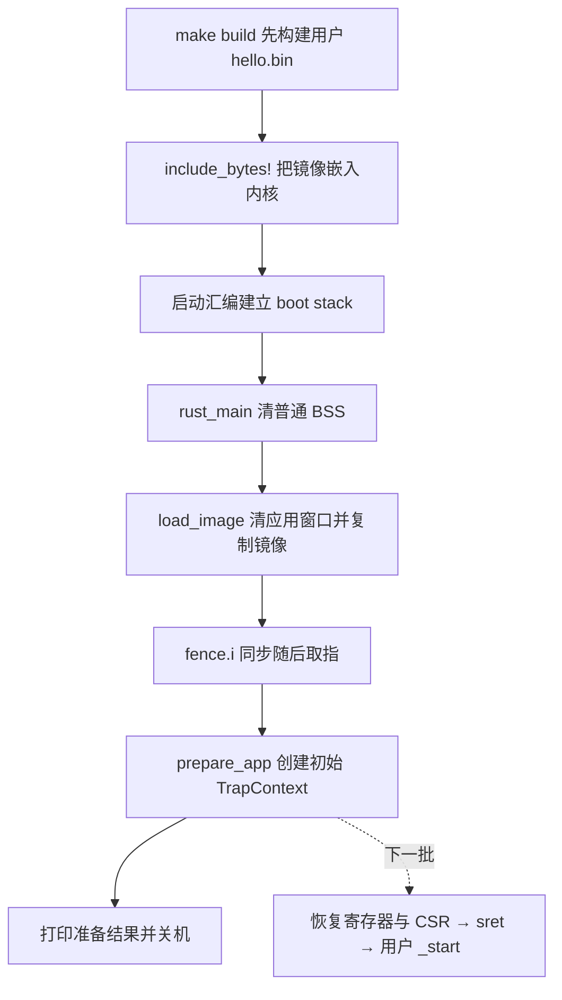

# 第四批：装载应用，准备两条栈和初始上下文

第三批用户 ELF/bin 已完成静态验收。本批接第二章“实现批处理系统”的装载部分，
并准备“特权级切换”需要的初始现场。核心函数由你填写，构建接线已经做好。

本批完成后：内核把 hello.bin 复制到固定 RAM 地址，准备用户栈和应用内核栈，
打印入口、栈顶和上下文地址，然后正常关机。用户 Hello 等下一批进入 U-mode 后才出现。

## 整条路径和本批位置



第二章还没有页表和 PMM。两条栈是静态数组，位于内核 BSS 中；
应用窗口是 QEMU RAM 中预留的一段固定地址。特权级切换和地址翻译是不同机制。
按教程顺序到第四章再做地址空间，本章尚不提供完整的用户/内核内存隔离。

| 内存或状态 | 用途 |
| --- | --- |
| boot stack，64 KiB | 当前启动与 rust_main 正在使用的栈 |
| USER_STACK，8 KiB | 将来应用在 U-mode 执行时使用的栈 |
| KERNEL_STACK，8 KiB | 将来应用陷入 S-mode 时使用的栈；顶部先存初始上下文 |
| `[0x80400000, 0x80420000)` | 128 KiB 应用窗口，接收独立链接的用户 bin |
| TrapContext | 32 个整数寄存器以及 sstatus/sepc 的内存副本 |

三条栈不是一个东西。本批运行时仍用 boot stack；两条新栈只是准备好。
链接脚本安排内存地址，不会设置寄存器。`include_bytes!` 在编译时嵌入字节，
不会让 QEMU 自动把用户镜像装到 0x80400000；这次复制由内核自己做。

## 已经接好的部分

- `os/src/loader.rs`：镜像嵌入、固定地址常量、两条可写静态栈、读取 sstatus 的小函数。
- `os/src/trap/context.rs`：上下文的字段与布局；`trap/mod.rs` 导出模块。
- `os/src/main.rs`：新增 loader/trap 模块声明，保留第一章实现。
- `os/src/linker.ld`：`ekernel <= 0x80400000` 断言，阻止内核、嵌入镜像或栈覆盖应用窗口。
- Makefile：`build` 先完成 `user`，保证 include_bytes! 能找到最新 hello.bin。

只读嵌入镜像是源，固定应用窗口是目标。两者不能重叠。
当前先处理一个应用，直接用 include_bytes!；官方多个应用的镜像表和切换管理留到后面。
不要复制官方整套 batch 管理器，也不需要新增依赖。

`compile_error!` 是本批未完成标记。整批填写完再移除；不要带着正常路径的 todo! 运行。
因此当前 `make user` 可用，`make build/run` 会被这个标记阻止，属于预期现象。

## A. 填写 TrapContext::app_init_context

函数输入：入口地址、用户栈顶、当前 sstatus 数值；输出一个完整的 TrapContext。

1. 把 `x` 初始化为 `[0; 32]`。
2. 把用户栈顶写入 `x[2]`：RISC-V 的 x2 就是 sp。
3. `sepc` 保存入口，后续 sret 从这里开始执行。
4. 保存的 `sstatus` 清除 SPP（第 8 位），其它位保留：`current_sstatus & !SSTATUS_SPP`。

这里先用原始 usize 位运算：`!mask` 按位取反，`value & !mask` 清除选中的位。
不要改真实的 sstatus CSR，也不在这一步开定时器或中断。
SPP=0 为下一次 sret 选择 U-mode；SPP 不是查询当前模式的通用字段。

`#[repr(C)]` 保证后续汇编能按固定偏移读取字段。RV64 中 usize 为 8 字节：

| 字段 | 偏移 | 长度 |
| --- | --- | --- |
| x[0..32] | 0 | 256 字节 |
| sstatus | 256 | 8 字节 |
| sepc | 264 | 8 字节 |
| 总长 | — | 272 字节 |

本批构造的是一个“应用尚未执行过”的现场，所以其它整数寄存器为零。
后续 trap 保存现场时才会记录应用实际运行中的寄存器值。

## B. 填写 load_image

接口 `load_image(image: &[u8]) -> Result<usize, &'static str>`：成功返回镜像字节数，
失败返回固定错误消息。仅供单 hart 启动阶段调用，此时还没有应用运行或借用目标内存。

必须按这个顺序：

1. 在任何写入前拒绝空镜像、长度超过 APP_SIZE_LIMIT 的镜像。
2. 在任何写入前确认源区间与整个目标窗口不相交。源起点来自 `image.as_ptr() as usize`，
   终点用 `checked_add(image.len())`，溢出返回 Err；目标终点为 APP_BASE_ADDRESS + APP_SIZE_LIMIT。
   两个半开区间相交条件：`source_start < target_end && target_start < source_end`。
3. 将应用窗口的全部 APP_SIZE_LIMIT 个字节清零，保留每次写入，可使用 `write_volatile(0)`。
4. 按原顺序复制镜像字节到 APP_BASE_ADDRESS 起，每次使用 `write_volatile(*byte)`。
5. 执行 `core::arch::asm!("fence.i")`，再返回 `Ok(image.len())`。

尾部清零使本次镜像未覆盖的空间没有上次应用的残留；用户 _start 仍负责自身 BSS 初始化。
复制机器码后的 fence.i 用于随后取指看到新内容；它和将来页表变化用的 sfence.vma 作用不同。
本批不使用 memcpy 依赖，不给 fence.i 加 `nomem` 或 `pure`。

为 unsafe 块写出真实前提：固定区间位于可写 RAM，链接断言防止覆盖内核，
源/目标不重叠，所有偏移有界，当前单 hart 初始化没有并发访问或存活的目标借用。
volatile 保留写操作，但不提供互斥、原子性或合法地址检查。

`Result` 的 Err 表示可拒绝的输入，不能用 panic 代替这些检查。
`checked_add` 返回 Option，可以用 match 把 None 转为 Err；保持代码直白即可。

## C. 填写 prepare_app

接口返回 `Result<*mut TrapContext, &'static str>`。这里返回原始指针，
避免反复制造指向同一静态栈的长期 `&'static mut` 引用。

1. 先 `load_image(APP_IMAGE)?;`，失败立即返回，不写上下文。
2. 取得用户栈顶与内核栈顶。
3. 用 APP_BASE_ADDRESS、用户栈顶和 `read_sstatus()` 调用构造函数。
4. 将完整上下文写入 `kernel_stack_top - size_of::<TrapContext>()`，返回该地址的原始指针。

`?` 在这里表示：Ok 继续；Err 原样提前返回。这样装载失败不会接着创建现场。

取得栈地址的关键形式：

```rust
let bottom = core::ptr::addr_of_mut!(USER_STACK).cast::<u8>();
let user_stack_top = bottom as usize + STACK_SIZE;
// KERNEL_STACK 同理。
```

栈向低地址增长，栈顶是数组上边界，即末尾后一字节的地址，不是最后一个字节。
两个 Stack 都按 4096 字节对齐、大小 8192；两栈顶满足调用规范所需的 16 字节对齐。
272 也为 16 的倍数，因此上下文起点仍满足对齐并完整落在内核栈内。

写入现场的关键形式：

```rust
let context_pointer = context_address as *mut TrapContext;
// SAFETY: 说明这个槽位的范围、对齐、可写性和独占初始化前提。
unsafe { context_pointer.write(context); }
```

不要对 mutable static 调用产生引用的 `.as_ptr()` / `.as_mut_ptr()`，
也不要直接 `&mut USER_STACK`；本项目使用 Rust 2024，先用 addr_of_mut! 取得原始地址。
静态对象使用 `static mut` 是因为栈会被写入，不能把不可变 static 强转为可写内存。

## D. 接到 rust_main，打印准备结果

保留第一章日志和正常关机。在 `clear_bss()` 之后、关机之前调用 prepare_app。
先清 BSS 很重要：新栈位于普通 BSS；如果创建现场后再清 BSS，就会抹掉刚写入的数据。
链接脚本仍将正在使用的 boot stack 排除在清零区间外。

可以用这个接线骨架，核心三个函数仍由你完成：

```rust
let context_pointer = match loader::prepare_app() {
    Ok(pointer) => pointer,
    Err(message) => {
        crate::println!("[kernel] app preparation failed: {}", message);
        sbi::shutdown(true);
    }
};
// SAFETY: prepare_app 返回已完整初始化、仍有效的栈内现场；当前没有其它访问者。
let (entry, user_sp, saved_status) = unsafe {
    ((*context_pointer).sepc, (*context_pointer).x[2], (*context_pointer).sstatus)
};
crate::println!("[kernel] app loaded: entry={:#x} bytes={}", entry, loader::APP_IMAGE.len());
crate::println!("[kernel] user_sp={:#x} context={:#x} spp={}",
    user_sp, context_pointer as usize, (saved_status & trap::context::SSTATUS_SPP) >> 8);
```

日志先将字段读到局部变量，再交给格式化，避免对静态栈形成不必要的长期借用。
这里没有设置 CPU sp/sepc，也没有执行 sret；不要直接 call 用户 _start。

## 完成点与验证

整批写完、移除 guard 后：

```sh
cd /home/asus/tinyos/experiments/rcore-learning
make build
timeout 8s make run
```

预期出现 `entry=0x80400000`、`bytes=<当前 hello.bin 大小>`、`spp=0`。
user_sp 与 context 的具体地址随内核布局变化；两者应 16 字节对齐。
之后仍正常关机退出 0；本批没有用户 Hello，也不要求编写 trap 汇编。

**P0 由协作者承担**，你整批交回后集中检查。只做以下必要验证：

| 路径 | 验收条件 |
| --- | --- |
| 正常路径 | 无编译警告；入口/布局无重叠；RAM 镜像逐字节相等，整个剩余尾部为零；两栈各 8192 字节；现场 272 字节、x2 正确、其它寄存器零、sepc 正确、只清 SPP；正常退出 0 |
| 一条拒绝路径 | 临时副本传入 128 KiB + 1 字节镜像；返回 Err，原应用窗口及已准备的上下文均不改变 |

检查来源区间和空镜像的拒绝逻辑做静态审查，不额外追加测试矩阵。
协作者已在缓存临时副本完成构建和上述两条 QEMU 预检；它不代表作者骨架已经完成。
暂不追加 P1/P2 作业，也不重复第一章 panic/Cargo 清理。

## 三个理解小测（本批完成后再答）

1. hello.bin 已经被 include_bytes! 嵌入内核，为什么还要复制到 0x80400000？
2. 用户栈顶写进 x[2]、SPP 清零后，当前 CPU 的 sp 和模式变了吗？下一批谁真正修改它们？
3. 上下文为什么放在内核栈而不是用户栈？如果在 prepare_app 之后才 clear_bss，会发生什么？

官方依据：[实现批处理系统](https://rcore-os.cn/rCore-Tutorial-Book-v3/chapter2/3batch-system.html)、
[特权级切换](https://rcore-os.cn/rCore-Tutorial-Book-v3/chapter2/4trap-handling.html)。
源码按固定 ch2 提交 fc4af3367b7feebb2287b15fe3ff23757471e571 阅读；
这里采用单镜像嵌入和 core 位运算，保留同样的固定装载地址、两栈和 RV64 现场布局。
