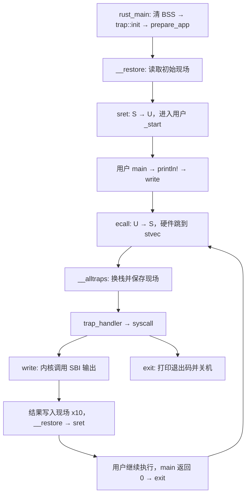

# 第五批：首次进入用户态，完成 write / exit 往返

状态（2026-10-14）：作者核心与正常/坏 write 两条 P0 已通过。下文 A—E 保留原实现任务，
文末“Trap 机制全景解析”是结合当前代码纠正后的完成笔记。

第四批已完成：镜像位于 0x80400000，两条新栈各 8 KiB，初始现场位于内核栈顶减 272。
当时 CPU 仍在 S-mode，用 boot stack 执行。现在把内存里的现场恢复到 CPU，
让第三批写好的用户代码真正运行，再由内核处理它的输出和退出。

本批目标日志：

```text
[kernel] enter U-mode
[user] Hello from U-mode!
[kernel] application exited: code=0
```

随后 QEMU 主动退出 0。`timeout 8s` 只提供等待上限；正常完成应早于超时，
出现 `terminating on signal 15 ... (timeout)` 只说明被超时终止。
当前 Makefile 的 run 目标不含 timeout；时间限制由终端命令的外层 timeout 提供，
并从启动 make 起计时，包含它的构建与运行阶段。

## 执行路径



用户 write 的 ecall 进入 S-mode；内核为输出调用 SBI 时，另一次 ecall 进入 M-mode。
RustSBI 返回内核后，内核再恢复用户现场。这两层接口各有自己的调用号和返回路径。

当前只运行一个应用，exit 后由内核决定关机。多应用切换放到下一批，第二章尚未结束。
用户库 `user_lib` 已承担入口、输出封装和 exit；未来按应用需求逐步增加接口即可。

## 已准备的文件

| 文件 | 本批责任 |
| --- | --- |
| os/src/trap/trap.S | 汇编入口和恢复；重复的寄存器读写已列好，填写 A/B/C/D 四处 |
| os/src/trap/mod.rs | 安装入口、处理 trap；enter_user 的 FFI 接线已经完成 |
| os/src/syscall.rs | write/exit 分发、用户缓冲区检查与字节输出 |
| os/src/loader.rs | 保留你的装载实现，新增 user_stack_bounds 供 write 检查 |
| os/src/main.rs | 已声明 syscall 模块；你补 init 和进入用户态的调用 |

沿用 core 和已有 sbi-rt，无新增第三方依赖。任务初始的 compile_error!
用于标记本批未完成，作者现已移除；当前 make build/run 和独立 make user 均可使用。

## 先认清 CSR、寄存器和内存现场

| 名称 | 这里的作用 |
| --- | --- |
| sp / x2 | 当前正在使用的栈指针 |
| sscratch | 由软件约定用途的 CSR；用户运行时保管内核栈顶 |
| stvec | S-mode trap 入口；本批使用 Direct 模式，低两位为 0 |
| sepc | trap 发生位置；sret 返回的位置 |
| scause | trap 原因；U-mode ecall 为 8，S-mode ecall 为 9 |
| stval | 异常附加信息；具体意义取决于异常种类 |
| sstatus.SPP | 此次 trap 前的特权级；恢复时选择 sret 的目标模式 |
| sstatus.SIE / SPIE | 当前 S 中断使能与 trap/返回时保存恢复的使能状态 |
| sie | 各类 S 中断的使能位；本批清零，不启用定时器 |

U-mode ecall 被委托到 S-mode 时，硬件设置 sepc/scause/stval，记录 SPP，
把 SIE 保存到 SPIE 并清 SIE，然后跳到 stvec。**硬件不会替你换 sp 或保存通用寄存器。**

TrapContext 是这些状态在 RAM 中的副本。读写 `context.sepc` 是访问内存，
`csrw sepc, t1` 才是写真实 CSR。sret 根据真实 sepc/sstatus 恢复执行。

## A. 完成 trap.S 四处

已经给出所有普通寄存器的 sd/ld，含 gp(x3)、tp(x4)，x0 槽写零。
x2 单独处理，不能在换栈后把内核 sp 当成用户 sp 保存。
整数寄存器槽为 `寄存器编号 * 8`；sstatus 偏移 256，sepc 偏移 264，总长 272。

本批用到的汇编语法：

| 写法 | 含义 |
| --- | --- |
| `csrr t0, sstatus` | 把 CSR 读到普通寄存器 t0 |
| `csrw sepc, t1` | 把 t1 写入 CSR |
| `csrrw sp, sscratch, sp` | 交换 sp 与 sscratch 的旧值 |
| `sd t0, 256(sp)` | 向 sp+256 的内存写 8 字节 |
| `ld t0, 256(sp)` | 从对应内存读 8 字节 |
| `addi sp, sp, -272` | 栈向低地址增长，预留 272 字节 |
| `mv a0, sp` | 将现场地址作为第一个函数参数 |

**A 段：刚进入 __alltraps。**

1. 交换 sp/sscratch：sp 得到内核栈顶，sscratch 暂存用户 sp。
2. sp 减 272，预留整个 TrapContext，再执行已有的寄存器保存指令。

**B 段：普通寄存器已经保存。**

1. 现在可以使用 t0/t1/t2；把 sstatus/sepc 分别读入 t0/t1，保存到对应槽位。
2. 把 sscratch 中的用户 sp 读入 t2，保存到偏移 16，即 x[2]。
3. 将现场地址放进 a0，`call trap_handler`。
4. Rust 返回时，a0 应是现场地址；下一条顺序执行 __restore。

**C 段：__restore 的入口。** 首次运行与 syscall 返回共用这条路径。

1. `mv sp, a0`，让 sp 指向要恢复的现场。
2. 从现场读出 sstatus、sepc、用户 sp，分别写入真实 sstatus、sepc、sscratch。
3. 随后执行已有的通用寄存器恢复指令。

**D 段：其它寄存器已经恢复。**

1. sp 加 272，回到内核栈顶。
2. 再交换 sp/sscratch：sp 变成用户 sp，sscratch 重新保管内核栈顶。
3. `sret`，从 sepc 指定的位置以 SPP 选择的模式继续执行。

| 时刻 | sp | sscratch |
| --- | --- | --- |
| 用户运行 | 用户栈当前位置 | 内核栈顶 |
| trap 入口第一次交换后 | 内核栈顶 | 用户栈当前位置 |
| Rust handler 运行 | 内核栈内，现场下方还会有 Rust 栈帧 | 用户栈当前位置 |
| 返回前释放 272 字节后 | 内核栈顶 | 将要恢复的用户 sp |
| 最后交换并 sret | 用户 sp | 内核栈顶 |

首次进入也走 C/D，因此无需在 Rust 里另给 sscratch 设置初值。
两个栈顶及 272 字节偏移都满足 16 字节对齐；调用 Rust 时必须保持这个条件。

## B. 完成 trap::init

把 `__alltraps` 的地址写进 stvec。汇编入口已 `.balign 4`，地址低两位为零，
直接写入即选择 Direct 模式。

取得函数地址的形式：

```rust
let entry = __alltraps as *const () as usize;
```

inline asm 内按顺序执行：

```text
csrci sstatus, 2       # 清 SIE（第 1 位）
csrw sie, zero        # 各类 S 中断全部关闭
csrw stvec, {entry}   # {entry} 对应 Rust asm 的 entry = in(reg) entry
```

这是在 S-mode 初始化，放入带前提说明的 unsafe 块。
Rust 字符串写指令，`entry = in(reg) entry` 让编译器选择普通寄存器装载该地址；
花括号只是这条 asm 模板的占位符。可加 `options(nostack)`，这些指令不访问栈。

本批必须同时清 sie。用户运行时 S 中断是否允许发生，不能仅靠当前 SIE=0 来判断。

## C. 完成 trap_handler

签名已经固定为 `unsafe extern "C" fn(*mut TrapContext) -> *mut TrapContext`：
输入和返回指针都通过 a0 传递，和汇编一致；no_mangle 保留 trap_handler 这个符号名。

1. 通过 inline asm 把 scause/stval 读到两个 usize 局部变量。
2. 根据汇编入口保证，在 unsafe 块中用 `&mut *context_pointer` 临时访问现场。
3. `cause == 8` 表示用户 ecall。完整值比较也排除了最高位为 1 的中断。
4. 将保存的 `sepc` 加 4。ecall 固定为 4 字节，即使目标支持压缩指令也是如此。
5. 从保存的 x[17] 取 syscall 编号；从 x[10]、x[11]、x[12] 取三个参数。
6. 调用 `crate::syscall::syscall`，把返回的 isize 转 usize 写回 x[10]。
7. 返回原 context_pointer，交给 __restore。

**两种“返回值”要分清**：Rust handler 的 a0 返回现场地址；用户要收到的结果存到现场 x[10]，
等恢复汇编加载 x10 后才成为用户的 a0。不能直接把 write 字节数当作现场地址返回。

对于其它用户 trap，打印 scause、现场 sepc、stval，再 `sbi::shutdown(true)`。
不要盲目加 4 并继续执行未知异常。建议日志：

```text
[kernel] unexpected trap: scause=... sepc=... stval=...
```

`&mut *pointer` 表示临时独占访问该指针所指对象；有效、对齐、已初始化的指针由汇编提供。
Rust 2024 的 unsafe fn 仍要求把内部危险操作明确放入 unsafe 块。

## D. 完成 syscall.rs

`syscall(id, arguments)` 使用普通 match：64 调用 sys_write，93 调用 sys_exit，
其它编号返回 -1。exit 的参数从 arguments[0] 转为 i32，恢复用户传来的退出码。

`sys_write(fd, buffer, length)` 按顺序处理：

1. fd 不是 1，返回 -1。
2. length 为 0，返回 0，无需访问 buffer。
3. 调用 user_buffer_is_readable；失败返回 -1，任何字节都不读、不输出。
4. 在合法范围内逐字节 `read_volatile()`，交给已有 `crate::sbi::console_putchar(byte)`。
5. 返回 length as isize。两个允许区域都很小，成功长度不会超过 isize 上限。

缓冲区地址检查的完整要求：

- 先通过 `start.checked_add(length)` 计算 end，溢出返回 false。
- `[start, end)` 必须完整落在应用窗口，或者完整落在 USER_STACK。
- 应用窗口由 loader 的 APP_BASE_ADDRESS/APP_SIZE_LIMIT 给出。
- 用户栈边界用已经提供的 `loader::user_stack_bounds()`。
- 区间包含条件为 `region_start <= start && end <= region_end`；两个区域判断用 `||`。
- 两区域之间的空隙、内核栈和内核只读区均不允许作为用户缓冲区。

为什么还检查用户栈？应用可以输出栈上的局部数组，数字格式化也可能产生栈内临时缓冲区。
检查整个区间后再读，避免“起点合法，但结尾越界”的访问。

本批直接读字节，无需构造 Rust 切片或把任意字节解释成 UTF-8。
unsafe 前提是范围已检查、区域已初始化、单 hart 上用户正暂停执行且没有并发写入。
地址检查约束系统调用的读操作；第二章尚无页表，完整内存隔离仍留到第四章。

`sys_exit(code) -> !` 输出 `[kernel] application exited: code={}`，然后：

```rust
crate::sbi::shutdown(code != 0);
```

`!` 表示函数不返回，所以退出分支不再进入 __restore。
这只是当前单应用内核的策略；将来有多个应用时，由内核在这里安排下一个应用。

## E. 接入 rust_main

在 `clear_bss()` 后、`prepare_app()` 前调用 `trap::init()`。
保留当前装载与地址日志，把末尾正常关机调用替换为：

```rust
crate::println!("[kernel] enter U-mode");
// SAFETY: trap 入口已安装，中断关闭，镜像和两条栈有效，现场已完整初始化。
unsafe { trap::enter_user(context_pointer) }
```

首次 __restore 会放弃继续使用 boot stack，把初始现场恢复到 CPU。
用户退出时由 sys_exit 决定关机，因此 rust_main 不再从 enter_user 返回。

这套入口只支持来自 U-mode 的 trap，内核处理过程不允许嵌套 trap。
关闭中断不能防止内核自身访问错误地址造成同步异常，所以内核指针必须满足上述前提。
本批也仅保存整数现场，未提供浮点/向量现场管理。当前 Hello 不使用这些状态。

## 必要验证与收尾

填完全部核心并移除 compile_error 后，从本学习目录执行：

```sh
make build
timeout 8s make run
echo $?
```

预期用户 Hello 一次、exit code=0 一次、命令退出 0，没有 timeout 终止行。
是否真的进入 U-mode，协作者还会用临时诊断核对 scause=8、保存的 SPP=0。

P0 由协作者承担，只做下面两个运行场景，并静态核对所有寄存器槽、对齐和错误分支：

| 场景 | 预期 |
| --- | --- |
| 正常 Hello | 真实 U ecall，write 成功返回用户，main 返回 0 并进入 exit，QEMU 正常退出 0 |
| 一条坏 write | 临时用户程序先用原始 ecall 传 `buffer=usize::MAX, length=2`；收到 -1，然后从栈内有效缓冲区输出并继续 Hello/exit，QEMU 退出 0 |

坏指针探针通过原始寄存器传参，不能先在 Rust 中构造非法切片。
这里验证拒绝不会让内核访存异常，以及 syscall 返回后用户仍能继续；不追加测试矩阵。
临时副本预检与作者完成后的两条 P0 均已通过，记录见 PROGRESS.md。正常路径、拒绝路径各一次即可；
未知用户异常的失败诊断先静态审查，不额外布置故障探针。

本批完成后的三个理解小测：

1. 用户 ecall 后，硬件做了什么，汇编又补了什么？为什么硬件跳到内核还不能立即调用 Rust？
2. 为什么 Rust handler 返回现场地址，而 write 的结果要写 x[10]？漏掉 sepc+=4 会怎样？
3. 首次进入用户态时没有先发生 trap，为什么仍能复用 __restore？此时 sscratch 最终保存什么？

官方依据：[实现特权级的切换](https://rcore-os.cn/rCore-Tutorial-Book-v3/chapter2/4trap-handling.html)，
代码仍按固定 ch2 提交 fc4af3367b7feebb2287b15fe3ff23757471e571 对照。
本实现把寄存器指令展开、补保存 tp、用 core asm 直接读写 CSR，并对 write 做固定区间检查；
官方的多应用管理和异常后切换下一应用将在随后批次接入。

## Trap 机制全景解析：硬件、汇编与 Rust 的分工

以下笔记按当前 RV64 单应用实现校正。`TrapContext` 共 272 字节，
整数寄存器数组占 256 字节，后面是各 8 字节的 sstatus 与 sepc。
用 `K` 表示内核栈顶，`U` 表示 trap 发生时的用户 sp，现场地址为 `K - 272`。

### 一、从用户 ecall 到 Rust handler

#### 1. 硬件自动完成什么

在本项目固件将 U-mode ecall 委托给 S-mode 的配置下，ecall 触发同步异常，
硬件在开始执行 S-mode 入口前完成这些状态转换：

- sepc 记录 ecall 本身的执行地址；本章未启用地址翻译，地址与相应物理 RAM 地址相同。
- scause 记录异常原因，U-mode ecall 的值为 8。
- stval 写入与异常相关的附加信息，本项目 ecall 通常为 0。
- sstatus.SPP 记录原先为 U-mode，即 0；SPIE 保存进入前的 SIE，随后 SIE 清零。
- CPU 进入 S-mode，PC 跳到 stvec 指定的入口。本项目使用 Direct 模式，入口为 __alltraps。

stvec 是保存入口地址与模式的控制状态寄存器（CSR）。SIE 清零涉及 S-mode 中断，
不能写成“关闭所有特权级的中断”；它也不会阻止同步异常。
硬件没有替我们保存整数寄存器或切换 sp。上述 CSR 状态语义见
[RISC-V Supervisor 规范](https://docs.riscv.org/reference/isa/v20260120/priv/supervisor.html)。

#### 2. 汇编 __alltraps 补齐什么

用户运行时，sp=U，sscratch=K。入口先执行：

```asm
csrrw sp, sscratch, sp   # sp=K，sscratch=U
addi sp, sp, -272       # sp=K-272，预留 TrapContext
```

第一次交换得到的是内核栈顶，减去 272 后才得到现场的起始地址。
随后按固定槽位保存整数寄存器；x2/sp 从 sscratch 读取，不能保存已经换成内核地址的 sp。
x0 恒为零，本实现把它的槽写零；x1、x3…x31 都有对应保存指令，包括 tp/x4。

等 t0/t1/t2 的原始值已经保存后，才用它们读取并保存 CSR 和用户 sp：

```asm
csrr t0, sstatus
sd t0, 256(sp)
csrr t1, sepc
sd t1, 264(sp)
csrr t2, sscratch
sd t2, 16(sp)           # 现场 x[2] 保存 U

mv a0, sp              # 第一个 C ABI 参数：现场地址
call trap_handler
```

当前使用 call，它建立 ra 返回地址。Rust handler 返回后，顺序执行紧接着的 __restore。
单独写 jr 只跳转，不会自动建立这个返回地址。

#### 3. 为什么不能直接让 Rust 接管

普通 Rust 函数依赖调用规范、合法栈和参数。它的函数序言、局部运算和后续调用会改变寄存器。
如果还没保存用户现场就直接执行，原寄存器值可能丢失；sp 若仍在用户栈上，
内核调用也会使用应用的栈，失去本项目预期的执行环境，并可能覆盖或耗尽用户栈。
这不代表每次都会立刻崩溃，但无法保证正确恢复应用。

汇编先保留现场并准备内核栈，Rust 才负责解释 scause、取 syscall 参数和处理服务。
本批只保存整数现场，尚不支持浮点/向量现场管理或来自 S-mode 的嵌套 trap。

### 二、处理结果与恢复现场

#### 1. handler 为什么返回现场地址

当前 handler 原样返回 context_pointer。__restore 用它找到要恢复的现场，
首次进入用户态也使用同一个指针接口。本批尚无任务调度。
后续有多任务时，可以设计为返回另一个任务的有效现场地址，再恢复那个任务。

#### 2. 用户返回值为什么写 x[10]

a0 是 x10 的 ABI 别名，ctx.x[10] 是其保存在 RAM 中的值。
当前接口约定：用户 a7/x17 提供编号，a0/a1/a2 提供参数，用户 a0 接收返回值。

```rust
let id = ctx.x[17];
let arguments = [ctx.x[10], ctx.x[11], ctx.x[12]];
let result = crate::syscall::syscall(id, arguments);
ctx.x[10] = result as usize;
```

有两种不同用途的 a0：Rust handler 返回时，真实 a0 携带现场地址；
等 __restore 加载现场的 x[10] 后，真实 a0 才变成用户 syscall 的结果。
因此 handler 返回现场指针，用户结果写入现场槽位。

#### 3. 为什么 sepc 加 4

ecall 固定占 4 字节，支持压缩指令也不会改变这一点。
硬件记录的是 ecall 自身地址；内核希望 write 返回后从下一条指令继续，所以修改保存的 sepc。
当前 handler 在所有 cause=8 分支中先加 4，再分发 syscall，包括 exit。

若可返回的 syscall 漏掉这步，sret 后会再次执行同一条 ecall，无法正常向后推进。
write 可能重复输出或因 a0 已变成结果而再次得到错误；不能简单假定每次参数完全相同。
exit 成功关机不返回，所以不会用到更新后的 sepc，也不会执行 __restore 的 D 段。

### 三、首次进入用户态与 sscratch 的闭环

#### 1. 从未发生 trap，为什么仍能恢复

恢复汇编只读取规定格式的内存现场。首次运行时，内核手动构造初始现场：

- sepc=应用入口 0x80400000。
- x[2]=用户栈顶；其它整数寄存器槽初始化为 0。
- 保存的 sstatus 清 SPP，选择随后 sret 进入 U-mode。
- 现场完整放在内核栈顶部，即 K-272。

把该地址作为 a0 交给 __restore，即可复用加载寄存器、切栈和 sret 的同一套代码。
这里构造的是首次执行状态，尚未发生一次真实 trap。

#### 2. 当前恢复汇编实际如何设置 sscratch

本项目 __restore 的关键步骤如下，普通寄存器加载用注释省略：

```asm
mv sp, a0
ld t0, 256(sp)
ld t1, 264(sp)
ld t2, 16(sp)
csrw sstatus, t0
csrw sepc, t1
csrw sscratch, t2       # 暂存要恢复的用户 sp

# 加载普通寄存器，包括 t0/t1/t2 和用户 a0；仍不加载 sp

addi sp, sp, 272        # 从现场地址回到 K
csrrw sp, sscratch, sp  # sp=用户 sp，sscratch=K
sret
```

不能把尾部简化成 `csrw sscratch, a0; sret`：恢复普通寄存器后，a0 已经是用户的值，
而且栈切换和释放现场这两步都不能省略。

成功进入用户态时，sscratch 严格保存 K，即内核栈顶；现场起点 K-272 与它相差 272 字节。
两者不能互换。处理 trap 期间，sscratch 暂存的是用户 sp，所以也不能写成“永远保存内核栈顶”。

| 阶段 | sp | sscratch |
| --- | --- | --- |
| 用户运行 | U | K |
| 入口交换后 | K | U |
| 预留现场后 | K-272 | U |
| handler 运行 | 在内核栈上继续建立 Rust 栈帧 | U |
| 恢复并释放现场后 | K | 要恢复的用户 sp |
| 返回用户后 | 用户 sp | K |

sret 不带参数，也不通过 ra 返回。它从真实 sepc 取得执行地址，按真实 SPP 选择特权级，
并执行 SIE←SPIE、SPIE←1、SPP←0 等状态更新；因此返回后的 sstatus 并非逐位保持 RAM 副本。
相关行为见[规范中的 SPP/SIE/SPIE 语义](https://docs.riscv.org/reference/isa/v20260120/priv/supervisor.html)。

### 四、应用退出为何没有写在 rust_main 末尾

用户 main 返回 0 后，返回到用户库 _start 的这两行：

```rust
let res = unsafe { main() };
exit(res);
```

用户 exit 包装把 a7=93、a0=0 放进寄存器并执行 ecall。
硬件再次跳到 stvec，随后 __alltraps→trap_handler→内核 syscall→内核 sys_exit。
内核 sys_exit 打印 application exited，再请求 SBI 关机；rust_main 没有直接调用这条退出链。
write 处理完恢复用户，exit 成功处理后则结束本次单应用系统。

### 五、timeout 命令与内核关机的区别

```sh
timeout 8s make run
```

这是终端把 make 放在一个 8 秒上限里运行。Makefile 的 run 目标自身没有 timeout。
若 make/QEMU 提前结束，timeout 立即返回其退出状态；若期限到达仍未结束，
默认发送 TERM（信号 15），通常返回 124。出现 from(timeout) 的终止行，就是后一种结束方式。
相关规则见[GNU timeout 手册](https://www.gnu.org/software/coreutils/manual/html_node/timeout-invocation.html)。

application exited 日志只证明内核已进入退出服务。是否主动关机，还要看 QEMU 是否自行退出。
这个上限不会要求 QEMU 必须运行满 8 秒，也不会把主动关机延迟到 8 秒。
