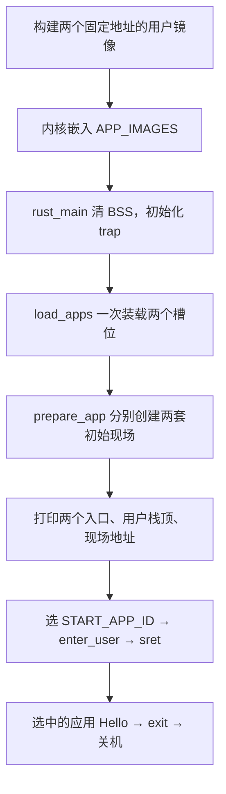

# 第六批：第三章开始——让两个应用同时驻留内存

状态（2026-10-15）：作者核心及正常 app 0 / 临时 app 1+非法编号两条 P0 已通过。
下文保留本批任务要求，具体验证记录见 PROGRESS.md。

按作者 2026-10-14 的选择，直接进入第三章“多道程序与分时多任务”。
第二章已有单应用 U/S 切换、write/exit；复用同一装载窗口并依次替换应用的批处理循环略过，
不把这部分记成已经实现。我们继续复用现有 Trap、用户运行库和装载代码。

第三章按以下顺序推进：

1. 多个应用同时放置与装载——本批。
2. TaskContext 与内核执行流切换。
3. yield、任务状态和协作式调度。
4. 定时器中断与抢占式调度。

本批完成点：两个镜像和两套独立的栈/现场同时存在，打印它们的位置，再启动选定应用。
一次启动仍只执行其中一个应用，exit 后沿用当前关机行为；调度在后续批次接入。

## 为什么先改变装载布局

之前只有一个应用窗口、一个用户栈和一个应用内核栈。
要在应用 A 暂停后让 B 执行，又能回到 A，必须保留 A 的代码、数据、栈和现场。
如果装载 B 时覆盖 A 的同一窗口，就无法直接恢复 A 继续执行。

因此先为两个应用保留不同位置：

| app_id | 程序 | 固定入口/槽位起点 | 槽位终点（不含） |
| --- | --- | --- | --- |
| 0 | hello | 0x80400000 | 0x80420000 |
| 1 | hello_peer | 0x80420000 | 0x80440000 |

每槽 128 KiB，即 APP_SIZE_LIMIT=0x20000。地址公式为：

```text
base(app_id) = APP_BASE_ADDRESS + app_id × APP_SIZE_LIMIT
```

两应用各有 8 KiB 用户栈和 8 KiB 内核栈，分别存放在两个静态数组中。
内核仍用独立的 64 KiB boot stack 初始化。用户/内核栈大小沿用本项目配置，
固定官方 ch3 的用户栈为 4 KiB、内核栈为 8 KiB，这里没有照抄其全部配置。

本章尚无页表/PMM。多应用共存是静态 RAM 布局，单 hart 一次仍执行一个应用；
应用之间还没有完整内存隔离。下一批增加切换后，它们才会轮流使用 CPU。

## 构建地址与装载地址要对应

两个应用分别链接到自己的地址，内核再复制到相同地址。
本章没有通用重定位机制，不能仅改变复制地址并假定所有应用都可随意移动。

构建接线已做好：

- 原 hello 和用户库保留，新增 hello_peer，输出 `[user1] Hello from slot 1!` 后返回 0。
- 用户链接脚本用 USER_BASE_ADDRESS，默认 0x80400000；内存上限使用“基址+128 KiB”。
- 构建 hello_peer 时，Makefile 用最终二进制的链接参数指定 0x80420000。
- `user/build.rs` 让 Cargo 跟踪链接脚本变化；构建过程不临时改写链接脚本。
- `make user` 同时生成两个 ELF/bin；内核仍用 include_bytes! 嵌入镜像数组。

```sh
cd /home/asus/tinyos/experiments/rcore-learning
make user
make user-inspect
```

两个 ELF 的 entry 应分别是 0x80400000 / 0x80420000。
当前构建无警告，两份 bin 都是 1013 字节；这是恰好同样大小，不是功能要求。
不要把实际文件长度与预留槽位长度混为一谈。

## 这一批的执行路径



load_apps 只装载镜像，prepare_app 只初始化现场。初始化全部发生在进入任何用户代码之前。
切换到第三章后，prepare_app 不再负责重新清零和复制镜像。
否则将来恢复暂停的应用时重新装载，会破坏它已经修改的数据。

## 已准备好的骨架与保留的实现

| 位置 | 已完成的接线 | 作者本批完成点 |
| --- | --- | --- |
| loader.rs | 镜像表、两组静态栈、编号检查 helper、栈边界 getter | app_base_address、load_apps |
| loader::load_image | 保留你的尺寸/重叠检查、清零、复制与 fence.i；新增 app_id 参数 | 确认目标基址来自 app_base_address |
| loader::prepare_app | 沿用你的现场构造/写入，改用对应应用的栈与入口 | 理解它现在只准备现场 |
| syscall.rs | write 检查改为选中应用的槽位/用户栈 | 无需重写读取循环 |
| main.rs | 原入口保留，prepare_app 调用已接新签名 | 加全体装载、两套现场与日志，再选择进入 |

任务初始的未完成标记位于 loader.rs，现已由作者移除；当前 make build/run/user 均可用。
第五批源代码、配置和 Makefile 的本地检查点保存在忽略目录
`.cache/batch05-before-ch3-xm7y6xw2/`，没有清理或还原作者代码。

## A. 填写 app_base_address

接口：`app_base_address(app_id: usize) -> Result<usize, &'static str>`。

1. 先调用已经提供的 `validate_app_id(app_id)?;`。
2. 按上述公式计算该应用的基址并返回 Ok。

编号只有 0/1。必须在索引和乘法前拒绝其它编号；不能仅检查 `app_id > APP_COUNT`，
编号等于 APP_COUNT 也非法。校验后的这两个固定编号不会使公式溢出或超出预留 RAM。
现有 load_image/prepare_app 都会先调用这个接口，因此非法编号必须在任何写入前返回 Err。

## B. 填写 load_apps

接口：`load_apps() -> Result<(), &'static str>`。

遍历 0..APP_COUNT，取 APP_IMAGES[app_id]，调用 `load_image(app_id, image)?;`，
全部完成后返回 `Ok(())`。你也可以使用 iter().enumerate() 同时取得编号和镜像。

这里 `()` 是 Rust 的单位类型，表示成功时没有额外的数据返回。
`?` 保留错误传播；单份镜像成功返回的字节数可以丢弃，错误不能忽略。
任一装载失败，rust_main 报告并停止启动；已经装载的槽位保留，用户还没有开始运行。

原 load_image 的清零/复制逻辑保留。每次只写对应的整个槽位，不能仍然都写到 0x80400000。
源来自内核嵌入镜像，内核链接断言保证内核与所有槽位分开。
每份复制后沿用 fence.i，保证该 hart 后续取指看到写入内容。

## C. main 中准备并观察两份现场

保留 clear_bss 和 trap::init，先调用 load_apps，成功后准备两份现场。
关键接线可按下面的写法替换 rust_main 中从单应用 prepare_app 到 enter_user 的整段，
保留前面的 clear_bss 和 trap::init，避免留下重复的准备或进入调用：

```rust
if let Err(message) = loader::load_apps() {
    crate::println!("[kernel] app loading failed: {}", message);
    sbi::shutdown(true);
}

let mut contexts = [
    core::ptr::null_mut::<trap::context::TrapContext>();
    loader::APP_COUNT
];

for app_id in 0..loader::APP_COUNT {
    contexts[app_id] = match loader::prepare_app(app_id) {
        Ok(pointer) => pointer,
        Err(message) => {
            crate::println!("[kernel] app preparation failed: {}", message);
            sbi::shutdown(true);
        }
    };

    // SAFETY: 对应栈内现场完整初始化，用户未开始运行，当前独占访问。
    let (entry, user_sp) = unsafe {
        ((*contexts[app_id]).sepc, (*contexts[app_id]).x[2])
    };
    crate::println!(
        "[kernel] app[{}] entry={:#x} bytes={} user_sp={:#x} context={:#x}",
        app_id, entry, loader::APP_IMAGES[app_id].len(),
        user_sp, contexts[app_id] as usize
    );
}

crate::println!("[kernel] enter app {}", loader::START_APP_ID);
// SAFETY: 镜像、栈和现场已准备好，trap 已安装且中断关闭。
unsafe { trap::enter_user(contexts[loader::START_APP_ID]) }
```

null_mut 在这里仅初始化指针数组的占位值。每一项在使用前都经过 prepare_app 成功赋值，
失败会直接关机，不能提前解引用空指针。
清 BSS 只在最开始执行一次；两个现场各在自己的内核栈顶减 272，不能共用一个槽位。

## D. 读懂栈数组与活动应用

两组栈改成 `[Stack; APP_COUNT]`。初始化中的 `[const { ... }; APP_COUNT]`
表示为每个数组元素分别进行常量初始化，不要求给大栈结构添加 Copy。
两个已提供的边界 getter 用原始静态地址加 `app_id * STACK_SIZE`，不会产生静态可变引用；
已校验编号，且编译期断言确认每个 Stack 恰好是 STACK_SIZE 字节。

START_APP_ID 默认 0，本批表示“本次启动选哪个应用”。write 只接受该应用的槽位或用户栈，
不能放宽成所有应用的区域。内核栈和嵌入源镜像仍不属于用户缓冲区。
下一批接调度器后，再由当前任务记录提供活动 id；当前常量不是一个调度器。

协作者会在临时副本改 START_APP_ID=1，验证第二个入口和 write 地址检查都正确。
这个实验只改变启动选择，不代表两个应用已经轮流执行。

## 完成点与必要验证

填写 A/B，接好 main，再移除标记后：

```sh
make build
timeout 8s make run
```

默认日志应有 app[0] entry=0x80400000 和 app[1] entry=0x80420000，
两者用户栈顶、现场地址各不相同且满足 16 字节对齐。
随后 enter app 0，原用户 Hello 一次、exit code=0 一次，主动退出 0。
本批不要求同一次运行出现两个用户 Hello。

P0 由协作者承担，最多两个 QEMU 运行：

| 场景 | 预期 |
| --- | --- |
| 默认启动 app 0 | 两槽镜像逐字节相等、各自完整零尾；两套独立栈/272字节现场的入口、x2/SPP/其它寄存器正确；app 0 正常执行退出 0 |
| 临时启动 app 1，加一条非法编号拒绝 | 两镜像和现场先准备好；对装载/准备接口传 app_id=2 返回 Err，所有原镜像/现场不变；app 1 的 Hello 正常输出并退出 0 |

构建阶段同时核对两 ELF 的入口和链接内存上限；其它尺寸/重叠拒绝逻辑静态审查，
不重复第一章 panic 或第五批坏 write 矩阵。临时预检及作者完成后的以上两条验证均已通过。

本批收尾的三个理解小测：

1. 为什么两个应用需要不同的链接基址，不能只在复制时改目标地址？
2. 两份镜像都驻留内存，为什么还需要各自的用户栈、内核栈和 TrapContext？
3. START_APP_ID=1 会改变什么？为什么它还不能让 app 0 和 app 1 轮流运行？

官方依据：[第三章引言](https://rcore-os.cn/rCore-Tutorial-Book-v3/chapter3/0intro.html)、
[多道程序放置与加载](https://rcore-os.cn/rCore-Tutorial-Book-v3/chapter3/1multi-loader.html)。
固定 ch3 提交为 9ca4aedb66f626dcc72f835a5946742a82b61c7c，已读取该提交的 loader/build.py；
本项目采用两个显式嵌入镜像和链接器参数选基址，沿用已验证的 core/Trap 实现。
